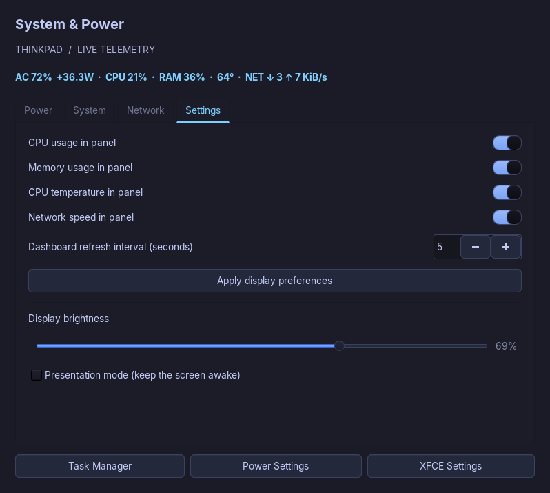

# Tokyo Night XFCE

A reproducible personal Void Linux/XFCE desktop for **bpseditor**. English throughout, with Japanese, Chinese, Cyrillic and emoji font coverage.



## One-command deployment

Run in a terminal **inside a logged-in XFCE session**, as your regular user:

```sh
curl -fsSL https://raw.githubusercontent.com/bpseditor/xfce-tokyo-night/main/bootstrap.sh | sh
```

Requires Void Linux, a working graphical XFCE session, internet access, `curl`, and permission to use `sudo`. The installer installs dependencies through XBPS. It does not install the OS, configure the display manager, or create a user. Log out and back in after installation.

The default automatically includes the power profile **only on ThinkPad T495s**. On other computers it installs the desktop profile. To skip hardware power settings:

```sh
curl -fsSL https://raw.githubusercontent.com/bpseditor/xfce-tokyo-night/main/bootstrap.sh | sh -s -- --power skip
```

For inspection before execution:

```sh
git clone https://github.com/bpseditor/xfce-tokyo-night.git
cd xfce-tokyo-night
./install.sh --dry-run
./install.sh
```

The bootstrap tracks `main`; for a frozen installation, check out a specific Git commit and run its installer. Upstream theme and font assets are pinned to commits in `install.py`.

## Included personal settings

- Tokyo Night GTK and XFWM theme, Papirus Dark icons, static mountain wallpaper.
- Inter UI font and JetBrains Mono terminal font; Noto CJK and emoji fallback.
- One 36px panel: application menu, four workspaces, application buttons, unified telemetry, tray, audio, keyboard layout, notifications, date and time.
- English **System & Power** dashboard: battery flow, watts, runtime estimate, charge thresholds, CPU, temperatures, fan, memory, swap, disk and network rates.
- Dashboard preferences for panel metrics, window refresh interval, brightness and presentation mode. Panel updates every five seconds.
- English eye-break reminder every 20 minutes, started after XFCE login, with duplicate-instance protection.
- Four workspaces; `Ctrl+1…4` switches and `Alt+1…4` moves a window. Workspace add/delete bindings (`Alt+Insert`, `Alt+Delete`) are disabled.
- Personal window bindings, including `Alt+Left/Right` tiling and `Alt+AudioMicMute` closing a window. These replace the corresponding XFCE bindings; review `config/xfconf.json` if sharing this profile.
- Private `umask 077` in supported shell startup files; screen lock on suspend and after idle; battery dimming and DPMS timers.

Existing panel composition is replaced. User files and affected XFCE properties are backed up under `~/.local/state/xfce-tokyo-night/backups/`. Re-running the installer reapplies the profile and creates another backup. Files managed by this repository are replaced; unrelated application settings are left alone.

## ThinkPad T495s power profile

- Charge up to 80%. After reaching the cap, use AC power without forced discharge; ordinary restart threshold is 40%.
- Reconnect AC to top up again, including from 70%; the temporary start threshold is 79%. Boot/resume on AC also permits a top-up.
- On battery: CPU cap 1.7 GHz, boost off, GPU `low`, AMD adaptive backlight level 2. On AC: CPU cap 2.1 GHz, boost allowed, GPU `auto`.
- TLP plus a small runit `charge-guard` service. Charge limits remain subject to the embedded controller and rounding.

The 80% cap reduces stored energy compared with a full charge. CPU limits can slow heavy work. Adaptive backlight can affect image appearance. Battery watts on AC measure charging flow, **not total wall consumption**. Runtime and capacity are controller estimates. No artificial 80→40 cycling is enabled.

## Recovery

The installer prints a command such as:

```sh
python3 ~/.local/state/xfce-tokyo-night/backups/TIMESTAMP/restore.py
```

Run it from your XFCE session. Desktop restore recovers managed files and properties; installed packages are retained. The power installer separately prints a root-owned recovery script under `/var/backups/xfce-tokyo-night-*/restore.sh`; run that with `sudo` to recover the previous TLP/guard setup.

## Privacy and scope

This repository was assembled from an explicit file/property allowlist, not a home-directory export. It contains no SSH/GPG keys, WireGuard/VPN configuration, passwords, browser profiles, shell history, auth tokens, application databases or private service configuration. Screenshots show controlled demo content and nonsensitive telemetry.

Network configuration, traffic-masq, mindmap and cvss-notification deployments are intentionally outside this desktop profile. Destructive package/service cleanup, full-disk encryption, Secure Boot and full system upgrades are not automated here. The installer does not remove Samba/Tor or disable networking services on a newly installed system.

## Screenshots and fixes

[Terminal](screenshots/terminal.png) · [Menu](screenshots/menu.png) · [Notification](screenshots/notification.png)

The desktop was reviewed using real screenshots of eight scenarios. Fixes include readable selected menu categories, correctly configured XFCE Terminal 1.2 through xfconf, contrast in Alt+Tab, clear inactive titles, useful desktop label widths, notification styling and a compact dashboard. The installer has syntax, manifest, dry-run and download checks; it has **not** been tested through a complete fresh-OS installation.

## Third-party assets

The installer downloads [TokyoNight XFCE](https://github.com/Bukutsu/tokyonight-xfce) at a pinned commit and applies local CSS corrections. It downloads [Inter](https://github.com/google/fonts/tree/main/ofl/inter) and [JetBrains Mono](https://github.com/google/fonts/tree/main/ofl/jetbrainsmono) with their OFL license files at a pinned Google Fonts commit. Papirus and Noto are installed from Void packages. Upstream assets retain their own licenses; this repository does not relicense them.
